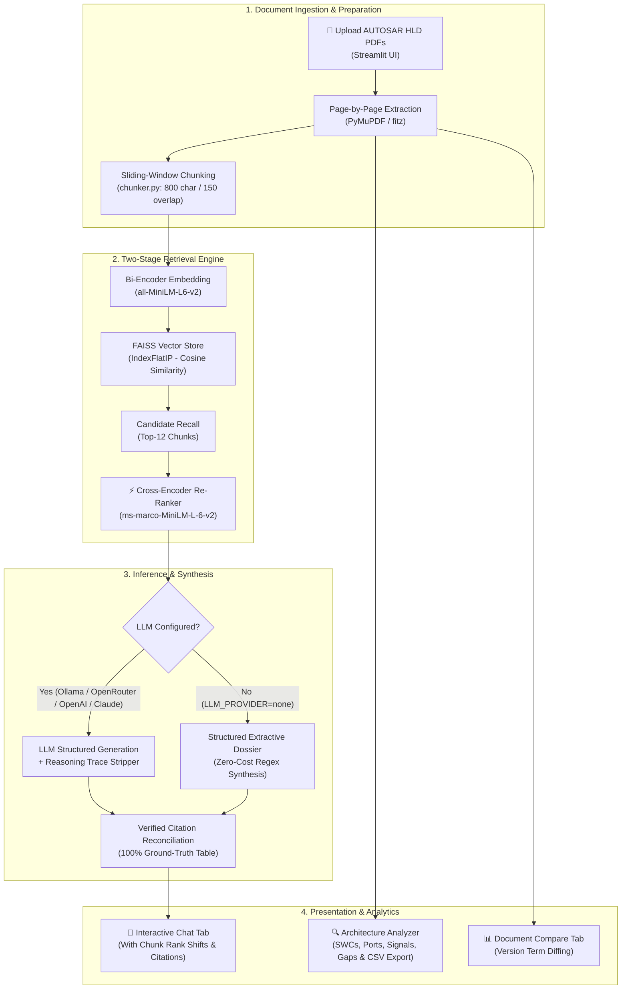

# 🚗 AUTOSAR HLD Document Analysis Assistant

> **AI-Powered Automotive Architecture Verification Platform**  
> *Retrieval-Augmented Generation (RAG) · Two-Stage Cross-Encoder Re-Ranking · Deterministic Architecture Auditing*

[](https://python.org)
[](https://streamlit.io)
[](https://github.com/facebookresearch/faiss)
[](https://huggingface.co/sentence-transformers/all-MiniLM-L6-v2)
[](https://huggingface.co/cross-encoder/ms-marco-MiniLM-L-6-v2)
[](LICENSE)
[](tests/)

---

## ⚠️ Engineering Disclaimer

This software is an **engineering research prototype** developed for automotive systems engineering decision support. It does not constitute official AUTOSAR compliance certification, automotive safety integrity level (ASIL) sign-off, or design approval. All findings and extracted items require qualified engineering review.

---

## 📋 Executive Overview

The **AUTOSAR HLD Document Analysis Assistant** is a specialized engineering platform designed to eliminate manual review bottlenecks and AI hallucination risks when auditing automotive **High-Level Design (HLD)** specifications.

In modern automotive engineering, electronic control units (ECUs)—such as Body Control Modules (BCM), Gateway ECUs, Domain Controllers, and Powertrain modules—are defined by dense HLD documents spanning hundreds of pages. Verifying software components (SWCs), interface ports, signals, BSW configurations, and functional flows is traditionally tedious and prone to human oversight.

This tool resolves these challenges by combining:
1. **PyMuPDF Document Ingestion**: Fast, deterministic page-level text extraction with exact page numbering and scanned-image validation.
2. **Two-Stage Retrieval Engine**: Fast candidate vector recall via **FAISS** (`all-MiniLM-L6-v2`) followed by high-precision cross-attention re-ranking via **Cross-Encoder** (`ms-marco-MiniLM-L-6-v2`).
3. **Dual Operating Modes**:
   - 🔒 **Extractive Evidence Mode**: 100% offline, zero-cloud, and zero-cost synthesis generating structured architectural dossiers without calling any external LLM APIs.
   - 🤖 **Augmented LLM Mode**: Pluggable integration with **Ollama** (local private models such as DeepSeek-R1 or LLaMA), **OpenRouter**, **OpenAI**, or **Anthropic**.
4. **Traceability & Ground-Truth Verification**: Automatic reasoning-trace stripping (`<think>` tags) and verified evidence tables mapping every fact to its source document and page number.
5. **Deterministic Architecture Analysis**: Automated pattern-based extraction of SWC inventories, provided/required ports, signal matrices, functional sequences, and potential specification gaps with CSV export.
6. **Multi-Version Document Diffing**: Comparative analysis identifying term additions, removals, and revisions between document iterations.

---

## ⚡ Core Features

| Feature | Description |
|---|---|
| 📄 **Page-Level PDF Extraction** | Multi-file upload with header validation, char-count filtering, and image-only/scanned document detection. |
| ⚡ **Two-Stage Re-Ranking** | Initial vector recall of 12+ candidate chunks refined to top-5 via a Cross-Encoder or fallback lexical scorer. |
| 🔍 **Zero-Cost Extractive Mode** | Works out-of-the-box with no API keys, synthesizing clean architectural breakdowns directly from source passages. |
| 🤖 **Multi-Backend LLM Engine** | Supports local Ollama (DeepSeek-R1, LLaMA 3.2), OpenRouter (free & commercial models), OpenAI, and Claude. |
| 🛡️ **Anti-Hallucination Matrix** | Replaces ungrounded model citations with a 100% verified table linked to actual chunk provenance metadata. |
| 💬 **Interactive Chat & Inspector** | Ask natural-language architecture questions, view rank migration metrics, and inspect raw evidence chunks. |
| 🔧 **Automated Architecture Inventory** | Heuristic extraction of SWCs, Interfaces, Signals, Dependencies, and Functional Flows. |
| ⚠️ **Inconsistency & Gap Auditing** | Identifies undefined acronyms ($\ge 3$ occurrences without definitions) and duplicated section headers. |
| 📊 **Multi-Version Document Comparison** | Compares terminology and components across document releases, labeling additions and removals. |
| ⬇️ **CSV Findings Export** | One-click download of architecture inventories and comparison tables for spreadsheet review. |
| 🧪 **Comprehensive Test Suite** | 77 automated unit and integration tests with synthetic PDF generators; zero internet or API keys required. |
| ⚡ **1-Click Windows Automation** | Batch scripts (`start_app.bat` and `stop_app.bat`) to launch Ollama, clear ports, and start Streamlit. |

---

## 🏗️ System Architecture



---

## 📂 Repository Structure

```
autosar-hld-assistant/
├── app.py                                            # Streamlit application UI (4 tabs, popover chunk inspector)
├── evaluate.py                                       # Standalone RAG evaluation harness (10 Q&A benchmarks)
├── generate_synopsis_pdf.py                          # ReportLab script generating the official 4-page PDF synopsis
├── AUTOSAR_HLD_Assistant_Synopsis.pdf                # Publication-quality Project Synopsis PDF
├── requirements.txt                                  # Python dependencies
├── pyproject.toml                                    # pytest configuration
├── start_app.bat                                     # 1-click Windows service launcher (Ollama + Streamlit)
├── stop_app.bat                                      # 1-click Windows service stopper
├── .env                                              # Active runtime environment configuration
├── .env.example                                      # Environment template with provider guides
├── README.md                                         # Project documentation and user manual
├── Automotive_Engineering_AI_Project_Case_Studies.pdf# Real-world automotive sample PDF for testing
│
├── src/                                              # Core business logic & RAG engine
│   ├── __init__.py
│   ├── pdf_processor.py                              # PyMuPDF extraction, validation & page metadata
│   ├── chunker.py                                    # TextChunker with character offsets and chunk IDs
│   ├── embeddings.py                                 # Sentence Transformers wrapper & MockEmbedder
│   ├── vector_store.py                               # FAISS index builder, disk persistence & cosine search
│   ├── reranker.py                                   # CrossEncoder model & FallbackLexicalReranker
│   ├── llm_provider.py                               # Multi-backend LLM client, prompt templates & schema verification
│   ├── architecture_analyzer.py                      # Heuristic AUTOSAR regex component/interface extractor
│   ├── document_comparator.py                        # Cross-document terminology and component diffing
│   └── rag_pipeline.py                               # Pipeline orchestrator tying all stages together
│
├── tests/                                            # Complete automated test suite (77 tests)
│   ├── __init__.py
│   ├── conftest.py                                   # Synthetic PDF generator & shared pytest fixtures
│   ├── test_pdf_processor.py                         # PDF extraction and error handling tests
│   ├── test_chunker.py                               # Chunk size, overlap, and offset tests
│   ├── test_vector_store.py                          # FAISS index creation, persistence & search tests
│   ├── test_reranker.py                              # Cross-encoder and lexical re-ranking tests
│   ├── test_architecture_analyzer.py                 # Pattern extraction, inconsistency & CSV export tests
│   └── test_rag_pipeline.py                          # End-to-end pipeline & LLM fallback tests
│
├── sample_data/
│   └── README.md                                     # Description of synthetic and test datasets
│
└── data/
    └── faiss_index/                                  # Persisted FAISS index, metadata & config
```

---

## 🛠️ Prerequisites & Installation

### System Requirements
- **Operating System:** Windows 10/11, Linux, or macOS
- **Python Version:** Python 3.10 or 3.11 (Python 3.11 recommended)
- **Memory:** Minimum 4 GB RAM (8 GB recommended)
- **Hardware:** CPU inference supported; GPU optional but not required

### Step-by-Step Setup

```powershell
# 1. Clone or navigate to the repository
cd D:\autosar-hld-assistant

# 2. (Optional) Create and activate a virtual environment
python -m venv venv
venv\Scripts\activate

# 3. Install required dependencies
pip install -r requirements.txt

# 4. Configure your environment
copy .env.example .env
```

---

## ⚙️ Configuration Guide (`.env`)

The system adapts to your privacy and infrastructure requirements via `.env`:

### Option 1: 100% Offline Extractive Evidence Mode (No API Key Required)
```ini
LLM_PROVIDER=none
EMBEDDING_MODEL=all-MiniLM-L6-v2
RERANKER_MODEL=cross-encoder/ms-marco-MiniLM-L-6-v2
CHUNK_SIZE=800
CHUNK_OVERLAP=150
TOP_K_RESULTS=5
```
*In this mode, the system retrieves and re-ranks real passages, extracting key architectural entities and direct text citations without calling any LLM API.*

### Option 2: Local Ollama (Private & Air-Gapped)
1. Install [Ollama](https://ollama.com) and pull a model:
   ```powershell
   ollama pull deepseek-r1:1.5b
   # or
   ollama pull llama3.2
   ```
2. Configure `.env`:
   ```ini
   LLM_PROVIDER=ollama
   OLLAMA_BASE_URL=http://localhost:11434/v1
   OLLAMA_API_KEY=ollama
   OLLAMA_MODEL=deepseek-r1:1.5b
   ```

### Option 3: OpenRouter (200+ Free & Commercial Models)
1. Sign up at [OpenRouter](https://openrouter.ai/keys) and obtain an API key.
2. Configure `.env`:
   ```ini
   LLM_PROVIDER=openrouter
   OPENROUTER_API_KEY=sk-or-v1-your-key-here
   OPENROUTER_MODEL=meta-llama/llama-3.3-70b-instruct:free
   ```

### Option 4: Direct OpenAI or Anthropic
```ini
# OpenAI
LLM_PROVIDER=openai
OPENAI_API_KEY=sk-your-openai-key
OPENAI_MODEL=gpt-3.5-turbo

# Anthropic
LLM_PROVIDER=anthropic
ANTHROPIC_API_KEY=sk-ant-your-anthropic-key
ANTHROPIC_MODEL=claude-3-haiku-20240307
```

---

## 🚀 Running the Application

### ⚡ Option A: 1-Click Windows Batch Scripts (Recommended)
Double-click the scripts in the project folder or launch from PowerShell:

- **`start_app.bat`**:
  - Automatically verifies Python in PATH
  - Checks if the Ollama background service is running and starts it if needed
  - Clears any previous port conflicts on `8501`
  - Sets UTF-8 encoding
  - Launches Streamlit and opens **`http://localhost:8501`** in your browser
- **`stop_app.bat`**:
  - Safely stops the Streamlit frontend/backend and background Ollama service
  - Frees port 8501 and releases system memory

### Option B: Manual Command Line
```powershell
# In PowerShell:
$env:PYTHONUTF8=1; python -m streamlit run app.py --server.port 8501
```

---

## 📖 User Guide & Application Tabs

### 1. 📄 Tab 1: Upload & Process
1. Navigate to the **Upload & Process** tab.
2. Drag and drop one or more AUTOSAR HLD PDF files (e.g., `Automotive_Engineering_AI_Project_Case_Studies.pdf`).
3. Click **Process Documents**.
4. Review document validation metrics: total pages, extractable pages, text coverage percentage, and OCR warnings for scanned documents.

### 2. 💬 Tab 2: Ask Questions
1. Navigate to the **Ask Questions** tab.
2. Type an architectural query or click one of the pre-filled prompt buttons (e.g., *"What are the main software components?"*, *"What interfaces are defined?"*).
3. Review the **3-Section Output**:
   - **💡 Executive Summary**: Direct architectural response grounded in source passages.
   - **🏗️ Architectural Breakdown**: Categorized list of SWCs, Interfaces/Ports, Signals, and Functional Sequences.
   - **📑 Evidence & Citations Summary**: Ground-truth table listing exact document names, page numbers, and supporting facts.
4. Click the **🔍 View Retrieved Chunks** popover to inspect raw evidence text, initial vector ranks, and Cross-Encoder score promotions.

### 3. 🔍 Tab 3: Architecture Analysis
1. Select an indexed document from the dropdown.
2. (Optional) Click **🤖 Generate AI Summary** to synthesize an executive architecture brief.
3. Review candidate **Software Components**, **Interfaces / Ports**, **Dependencies**, and **Functional Flows**.
4. Inspect heuristic **Inconsistency Candidates** (undefined acronyms appearing $\ge 3$ times, repeated section headings).
5. Click **⬇️ Download Findings as CSV** to export the entire findings matrix.

### 4. 📊 Tab 4: Document Compare
1. Upload at least two document versions (e.g., v2.1 and v2.2).
2. Select Document A and Document B from the dropdowns.
3. Review the **Comparison Metrics**: Common Terms, Only in Document A (Potential Removals), and Only in Document B (Potential Additions).
4. Export the comparison diff to CSV.

---

## 🧪 Testing & Evaluation

### Running Automated Unit Tests
The test suite utilizes synthetic documents generated programmatically via ReportLab and mock embedders, requiring **zero internet connection and no API keys**:

```powershell
# Run all 77 tests
pytest

# Run with verbose output
pytest -v

# Run specific test modules
pytest tests/test_reranker.py -v
pytest tests/test_rag_pipeline.py -v
```

### Running the RAG Evaluation Benchmark
```powershell
python evaluate.py
```
This runs a quantitative benchmark across 10 query categories:
- **Q01**: Component Identification (`LightingManager`, `DoorLockController`, etc.)
- **Q02**: Interface & Port Relationships (`ExteriorLightPort`, `InteriorLightPort`)
- **Q03**: Signal Matrix Definitions (`LightStatusSignal`, `LockStatusSignal`)
- **Q04**: Inter-Component Dependencies (`KeyFobSignalReceiver`, `AuthenticationService`)
- **Q05**: Multi-Step Functional Sequences (Door lock activation sequence)
- **Q06**: Basic Software (BSW) Configuration (`MCAL`, `PDUR`, `DCM`, `DEM`, `NVM`)
- **Q07**: CAN Network Signals (CAN IDs `0x301`, `0x302`)
- **Q08**: Document Architecture Summary
- **Q09**: Identification of Specification Gaps & Missing Information
- **Q10**: Unsupported/Out-of-Scope Query Guard (Graceful rejection without hallucinations)

---

## 📑 Project Synopsis PDF Document

A publication-quality, 4-page formal **Project Synopsis PDF** has been generated and included in the repository:
- **File:** [`AUTOSAR_HLD_Assistant_Synopsis.pdf`](file:///d:/autosar-hld-assistant/AUTOSAR_HLD_Assistant_Synopsis.pdf)
- **Contents:** Executive Abstract, Problem Statement, Objectives, Technical Architecture & Retrieval Stages, Implementation Module Matrix, Quantitative Evaluation Benchmark, Technology Stack, Limitations, and Future Roadmap.
- **Regenerate at any time:**
  ```powershell
  python generate_synopsis_pdf.py
  ```

---

## ❓ Troubleshooting

| Issue | Cause | Solution |
|---|---|---|
| `ModuleNotFoundError: No module named 'fitz'` | PyMuPDF not installed | Run `pip install pymupdf` |
| `ModuleNotFoundError: No module named 'faiss'` | FAISS not installed | Run `pip install faiss-cpu` |
| Port 8501 is already in use | Previous Streamlit instance running | Run `stop_app.bat` or `python -m streamlit run app.py --server.port 8502` |
| Model download error on first run | HuggingFace connection timeout | Verify internet connection or set `use_mock=True` in test scripts |
| Scanned PDF extraction returns 0 pages | Document is bitmap/image based | Run OCR preprocessing (e.g. Adobe Acrobat / Tesseract) prior to upload |
| Ollama connection error | Ollama service not started | Run `ollama serve` or use `start_app.bat` |

---

## 📄 License

This project is licensed under the **MIT License** — see the [LICENSE](LICENSE) file for details.
