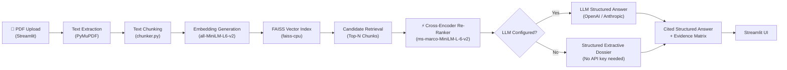

# AUTOSAR HLD Document Analysis Assistant

> **Engineering Prototype** | AI-Powered AUTOSAR HLD analysis using Retrieval-Augmented Generation (RAG)

[](https://python.org)
[](https://streamlit.io)
[](LICENSE)

---

## ⚠️ Disclaimer

This tool is an **engineering research prototype**. It does not constitute official
AUTOSAR compliance analysis, certification, or design approval. All findings require
qualified engineering review.

---

## Overview

A web application that allows automotive software engineers to:

- Upload AUTOSAR High-Level Design (HLD) PDF documents
- Ask natural language questions about software components, interfaces, signals, and architecture
- Receive evidence-based answers with source-page citations
- Analyse document structure with component inventory and dependency extraction
- Compare multiple document versions
- Export findings to CSV

The system uses **Retrieval-Augmented Generation (RAG)**: it retrieves relevant passages from indexed documents and either presents them as extractive evidence (no LLM required) or passes them to a configured LLM for AI-generated answers.

---

## Features

| Feature | Description |
|---------|-------------|
| 📄 **PDF Upload** | Multi-file upload with validation and page-level extraction |
| ⚡ **Cross-Encoder Re-Ranking** | Two-stage retrieval: FAISS candidate recall + Cross-Encoder re-ranking |
| 📋 **Structured Answers** | Executive Summary, Key Entities, Detailed Flows, Evidence Matrix & Engineering Notes |
| 🔍 **Structured Extractive Mode** | Generates organized architectural dossiers with citations without any paid LLM |
| 🤖 **LLM Mode** | Optional OpenAI or Anthropic integration with structured schema |
| 💬 **Chat Interface** | Interactive Q&A with citations, score labels, and rank improvement tracking |
| 🔧 **Architecture Analysis** | Component, interface, signal, and dependency extraction |
| 📊 **Document Comparison** | Side-by-side term comparison between document versions |
| ⬇️ **CSV Export** | Download findings table as CSV |
| 🧪 **Automated Tests** | Full pytest suite (77 tests) with mock embedder and mock re-ranker |

---

## Architecture



---

## Prerequisites

- **Python 3.10 or later** (Python 3.11 recommended)
- **Windows 10/11** (also works on Linux/macOS)
- **Internet connection** for first-time model download (Sentence Transformers)
- At least **4 GB RAM** (8 GB recommended)
- No GPU required (CPU inference)

---

## Installation (Windows)

### 1. Clone or Download the Project

```powershell
# If using git:
git clone <repository-url> autosar-hld-assistant
cd autosar-hld-assistant

# Or navigate to the existing project folder:
cd D:\autosar-hld-assistant
```

### 2. (Optional) Create a Virtual Environment

```powershell
python -m venv venv
venv\Scripts\activate
```

### 3. Install Dependencies

```powershell
pip install -r requirements.txt
```

This installs:
- `streamlit` – Web UI framework
- `pymupdf` – PDF text extraction
- `sentence-transformers` – Embedding model (downloads ~90 MB on first use)
- `faiss-cpu` – Vector similarity search
- `python-dotenv` – Environment configuration
- `pandas` – Data handling and CSV export
- `pytest` – Automated testing
- `reportlab` – Synthetic PDF generation for tests
- `openai` – Optional OpenAI LLM integration

### 4. Configure Environment

```powershell
# Copy the example configuration
copy .env.example .env

# Edit .env with your preferred text editor
# Set LLM_PROVIDER=none to use extractive mode (no API key needed)
```

`.env` example for extractive mode (no LLM):
```
LLM_PROVIDER=none
EMBEDDING_MODEL=all-MiniLM-L6-v2
CHUNK_SIZE=800
CHUNK_OVERLAP=150
TOP_K_RESULTS=5
```

`.env` example for OpenAI:
```
LLM_PROVIDER=openai
OPENAI_API_KEY=sk-your-key-here
OPENAI_MODEL=gpt-3.5-turbo
```

`.env` example for Anthropic:
```
LLM_PROVIDER=anthropic
ANTHROPIC_API_KEY=sk-ant-your-key-here
ANTHROPIC_MODEL=claude-3-haiku-20240307
```

---

## Running the Application

### ⚡ Option A: 1-Click Windows Batch Scripts (Recommended)

Simply double-click the `.bat` files in the project folder:

- **`start_app.bat`**:
  - Automatically verifies and starts the **Ollama LLM service** (`http://localhost:11434`)
  - Configures UTF-8 encoding
  - Clears any previous port conflicts
  - Launches the **Streamlit Frontend and Backend** (`http://localhost:8501`)
  - Automatically opens the application in your default web browser

- **`stop_app.bat`**:
  - Safely stops the Streamlit Frontend and Backend
  - Safely stops the Ollama LLM service
  - Frees up port 8501 and system memory

---

### Option B: Manual Command Line

```powershell
# In PowerShell:
$env:PYTHONUTF8=1; python -m streamlit run app.py --server.port 8501
```

The application will open automatically at **http://localhost:8501**

---

## Running Tests

```powershell
# Run all tests
pytest

# Run with verbose output
pytest -v

# Run a specific test file
pytest tests/test_pdf_processor.py -v

# Run tests without internet (mock embedder already used by default)
pytest tests/ -v
```

> **All tests use a mock embedder** – no internet connection or API key required.
> Integration tests with the real sentence-transformers model can be added separately.

---

## Running the Evaluation

```powershell
python evaluate.py
```

This evaluates retrieval quality on 10 synthetic Q&A pairs covering:
- Component identification
- Interface relationships
- Signal definitions
- Dependencies
- Functional flows
- Document summaries
- Missing information
- Unsupported questions

---

## Using the Application

### Step 1: Upload Documents
1. Open the **Upload & Process** tab
2. Click "Select PDF files" and choose your AUTOSAR HLD PDFs
3. Click **Process Documents**
4. Review the processing results (page count, text coverage, warnings)

### Step 2: Ask Questions
1. Open the **Ask Questions** tab
2. Type your question in the chat box or click an example question
3. Review the answer with source citations
4. Expand **Retrieved Evidence Passages** to see the raw source text

### Step 3: Analyse Architecture
1. Open the **Architecture Analysis** tab
2. Select a document to analyse
3. Review component inventory, interfaces, dependencies, and functional flows
4. Download the findings CSV

### Step 4: Compare Documents
1. Upload multiple PDF versions
2. Open the **Document Compare** tab
3. Select two documents to compare
4. Review added/removed terms

---

## Example Questions

```
What are the main software components in this document?
What interfaces or ports does LightingManager provide?
What signals are defined on the CAN bus?
Describe the door lock functional sequence.
What BSW modules are configured?
Are there any missing specifications in this document?
What components depend on the DEM module?
Summarize the overall architecture.
```

---

## Project Structure

```
autosar-hld-assistant/
├── app.py                      # Streamlit web application (main entry point)
├── evaluate.py                 # RAG evaluation script with 10-question dataset
├── requirements.txt            # Python dependencies
├── pyproject.toml              # pytest configuration
├── .env.example                # Environment template (copy to .env)
├── .gitignore
├── README.md
├── src/
│   ├── __init__.py
│   ├── pdf_processor.py        # PDF validation and text extraction (PyMuPDF)
│   ├── chunker.py              # Text chunking with overlap and metadata
│   ├── embeddings.py           # Sentence Transformers + mock embedder
│   ├── vector_store.py         # FAISS index build, save/load, search
│   ├── rag_pipeline.py         # RAG orchestration
│   ├── llm_provider.py         # OpenAI / Anthropic / extractive mode
│   ├── architecture_analyzer.py # Component/interface/signal extraction
│   └── document_comparator.py  # Multi-document comparison
├── tests/
│   ├── __init__.py
│   ├── conftest.py             # Shared fixtures + synthetic PDF generation
│   ├── test_pdf_processor.py   # PDF extraction tests
│   ├── test_chunker.py         # Chunking and overlap tests
│   ├── test_vector_store.py    # FAISS index tests
│   ├── test_rag_pipeline.py    # End-to-end pipeline tests
│   └── test_architecture_analyzer.py  # Analysis and CSV export tests
├── sample_data/
│   └── README.md
└── data/
    └── faiss_index/            # Persisted index (created at runtime)
```

---

## Known Limitations

| Limitation | Details |
|------------|---------|
| **Scanned PDFs** | Image-only PDFs cannot be processed; OCR preprocessing required |
| **Mock embedder** | Test suite uses hash-based mock vectors, not semantic similarity |
| **No streaming** | LLM answers are returned all at once (no streaming) |
| **Single session** | Index is stored in `data/faiss_index/`; multiple users share it |
| **English only** | Sentence Transformers model is optimized for English text |
| **Heuristic analysis** | Component/interface extraction uses regex patterns, not structural parsing |
| **No PDF OCR** | Scanned AUTOSAR documents must be converted first |

---

## Troubleshooting

### `ModuleNotFoundError: No module named 'fitz'`
```powershell
pip install pymupdf
```

### `ModuleNotFoundError: No module named 'faiss'`
```powershell
pip install faiss-cpu
```

### Sentence Transformers model download fails
- Check your internet connection
- The model is downloaded to `~/.cache/huggingface/` on first use
- Set `use_mock=True` in code for offline testing

### Streamlit port already in use
```powershell
streamlit run app.py --server.port 8502
```

### `UnicodeDecodeError` in PDF processing
- The PDF may use a non-standard encoding; try converting it with Adobe Acrobat first

### Application reloads unexpectedly
- This is normal Streamlit behavior when source files change
- Use the `.streamlit/config.toml` to disable auto-reload in production

---

## Evaluation Methodology

The evaluation script (`evaluate.py`) tests the system against 10 synthetic Q&A pairs:

1. **Retrieval Relevance**: % of expected domain terms found in retrieved chunks
2. **Citation Correctness**: Citations reference real indexed documents (no fabrication)
3. **Answer Correctness**: Expected terms appear in the answer (extractive mode)
4. **Unsupported Question Handling**: Off-topic questions return appropriate responses
5. **Response Latency**: Time from query submission to answer delivery

> Evaluation uses the **mock embedder** (hash-based vectors). For production evaluation,
> use the real `all-MiniLM-L6-v2` model to measure true semantic retrieval quality.

---

## LLM Configuration Guide

### OpenAI

1. Create an account at https://platform.openai.com
2. Generate an API key
3. Add to `.env`:
   ```
   LLM_PROVIDER=openai
   OPENAI_API_KEY=sk-...
   OPENAI_MODEL=gpt-3.5-turbo
   ```

### Anthropic

1. Create an account at https://console.anthropic.com
2. Generate an API key
3. Install Anthropic SDK: `pip install anthropic`
4. Add to `.env`:
   ```
   LLM_PROVIDER=anthropic
   ANTHROPIC_API_KEY=sk-ant-...
   ANTHROPIC_MODEL=claude-3-haiku-20240307
   ```

### No LLM (Extractive Mode)

No configuration needed. Set:
```
LLM_PROVIDER=none
```

The application will display the top retrieved passages directly.

---

## Demo Script

Use these questions when demonstrating the project:

```python
demo_questions = [
    "What are the main software components in this AUTOSAR HLD?",
    "What ports does LightingManager provide?",
    "What CAN signals are transmitted by the BCM?",
    "Describe the door lock activation sequence.",
    "What dependencies does DoorLockController have?",
    "Are there any missing specifications mentioned in the document?",
    "What BSW modules are included in the stack?",
    "What is the purpose of this document?",
]
```

---

*Built with Python 3.11 · Streamlit · PyMuPDF · Sentence Transformers · FAISS · pandas*
